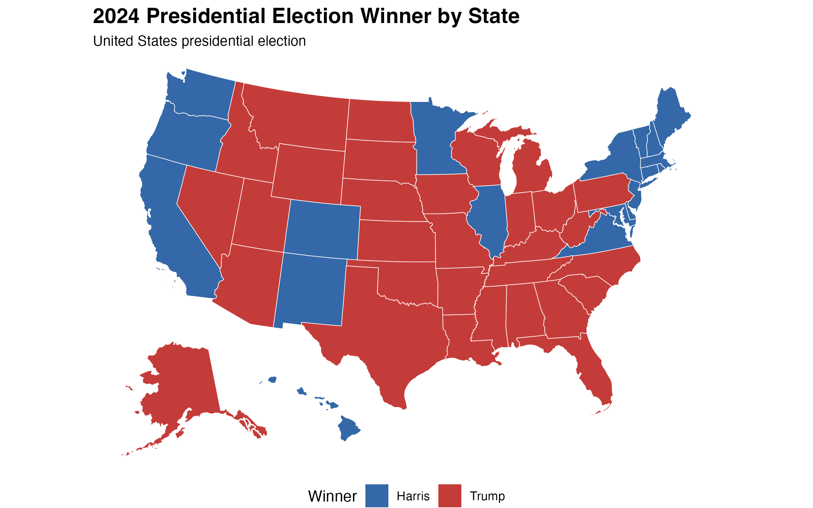
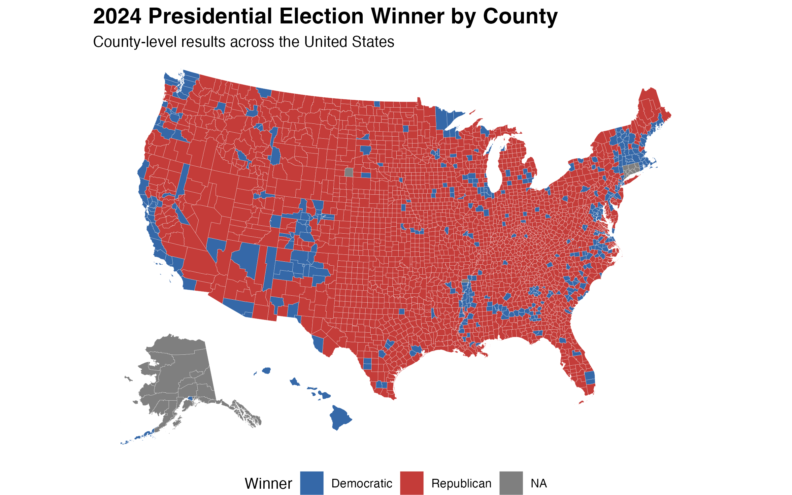
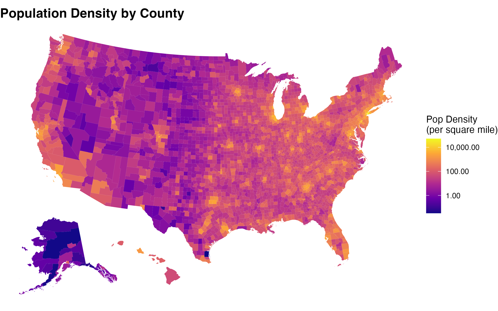
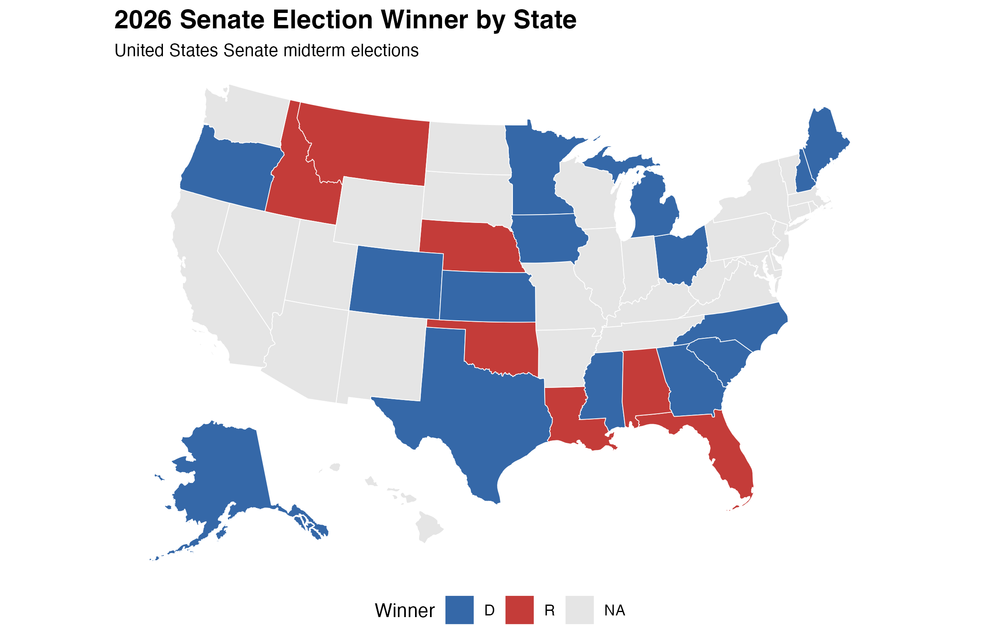
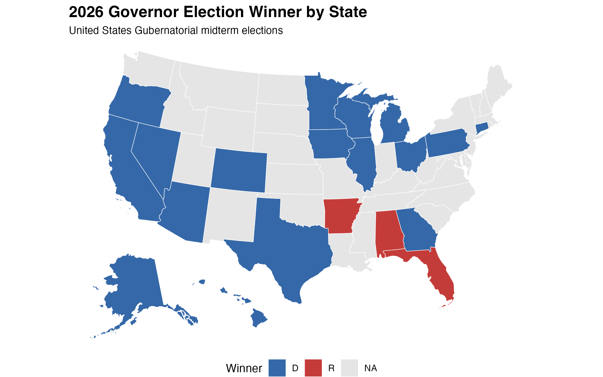
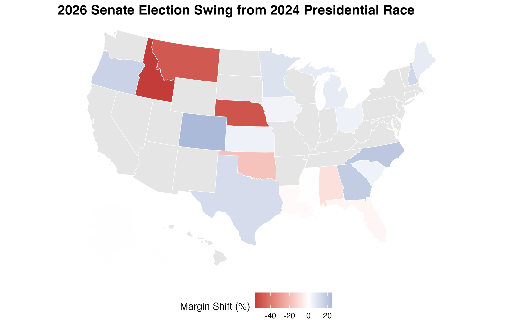
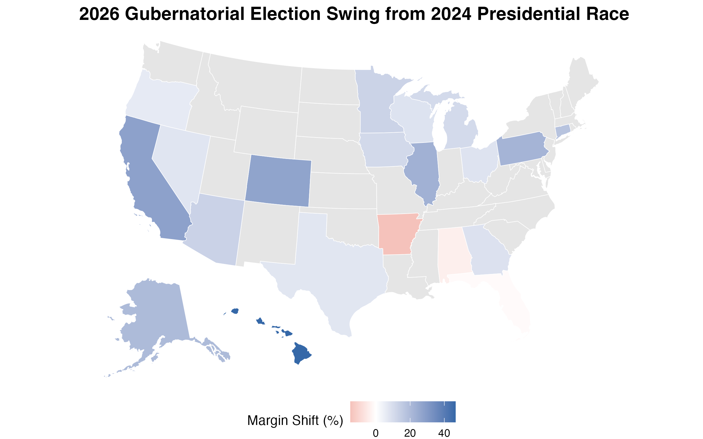
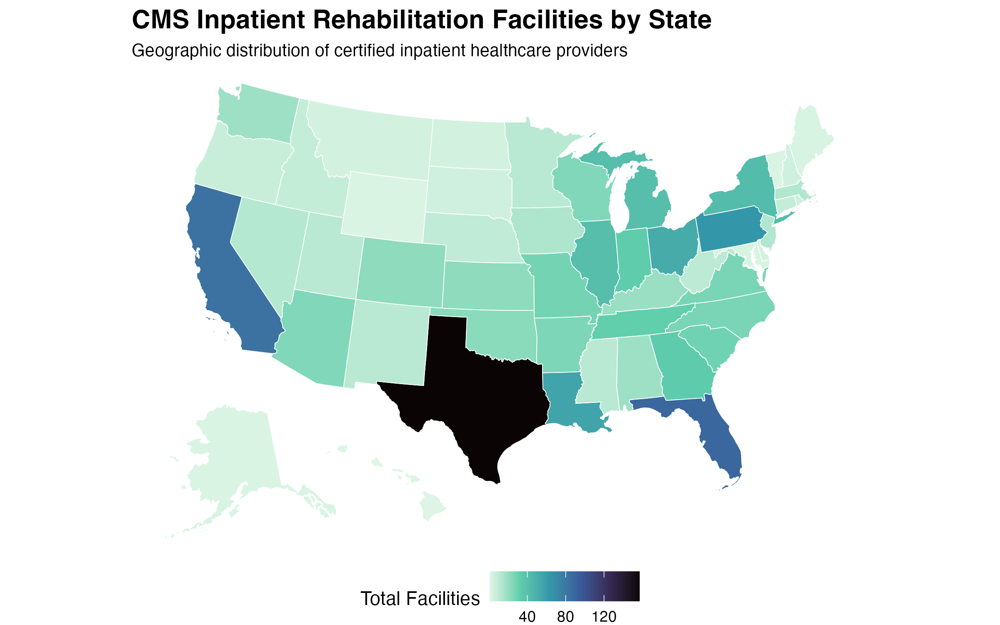
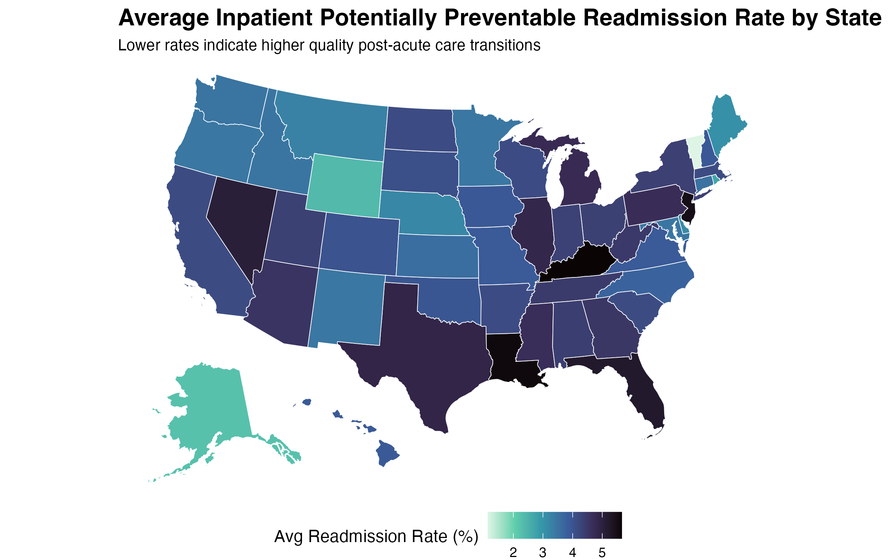

## My Maps

2024 Election Winner by State
{fig-align="center" width="70%"}

2024 Election Winner by County
{fig-align="center" width="70%"}

Population Density by County
{fig-align="center" width="70%"}

% Black by County
{fig-align="center" width="70%"}

2026 Election returns by State (Senate Winner)
{fig-align="center" width="70%"}

2026 Election returns by State (Governor Winner)
{fig-align="center" width="70%"}
Create maps that show swing (i.e., how much change there was) from the 2024 presidential election to 2026, by state, for:2026 Senate
{fig-align="center" width="70%"}

Create maps that show swing (i.e., how much change there was) from the 2024 presidential election to 2026, by state, for:2026 Senate
{fig-align="center" width="70%"}
Plot the (rough) location of Syracuse University on a national state map in a big blue or orange star.
{fig-align="center" width="70%"}

## Showcase

{fig-align="center" width="70%"}

{fig-align="center" width="70%"}
## Summary

