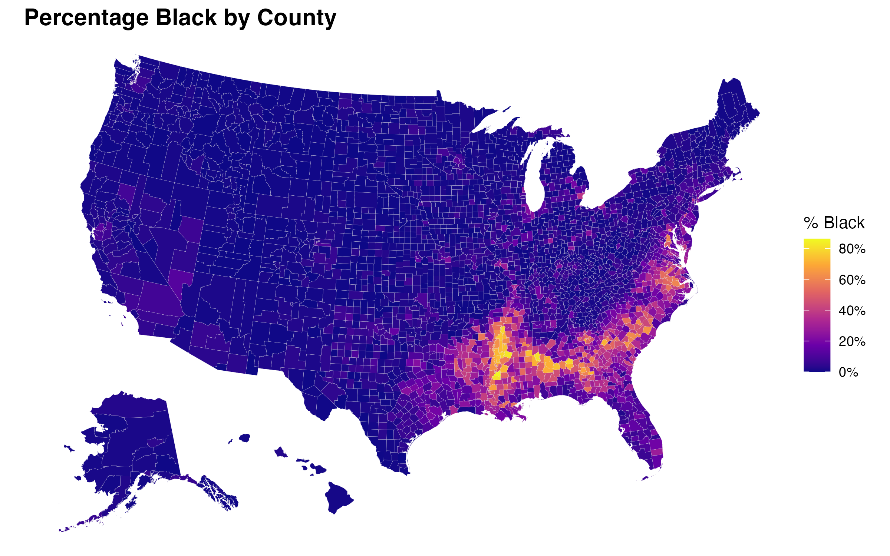

## My Data
For my election data for counties and states, I used the Healy guidelines. 

For my showcase graphs, I used the Inpatient Rehabilitation Facility - Provider Data (CSV) published by the Centers for Medicare and Medicaid Services (CMS). 

## My Maps

2024 Election Winner by State
{fig-align="center" width="70%"}

2024 Election Winner by County
{fig-align="center" width="70%"}

Population Density by County
{fig-align="center" width="70%"}

% Black by County
{fig-align="center" width="70%"}

2026 Election returns by State (Senate Winner)
{fig-align="center" width="70%"}

2026 Election returns by State (Governor Winner)
{fig-align="center" width="70%"}
Create maps that show swing (i.e., how much change there was) from the 2024 presidential election to 2026, by state, for:2026 Senate
{fig-align="center" width="70%"}

Create maps that show swing (i.e., how much change there was) from the 2024 presidential election to 2026, by state, for:2026 Senate
{fig-align="center" width="70%"}
Plot the (rough) location of Syracuse University on a national state map in a big blue or orange star.
{fig-align="center" width="70%"}

## Showcase

{fig-align="center" width="70%"}
This graph shows the geographic distribution of certified inpatient healthcare providers across the United States.Texas stands out dramatically with the highest count (darkest black color, exceeding 120 facilities), followed by California and Florida as major hubs.

{fig-align="center" width="70%"}
This graph displays average inpatient potentially preventable readmission rates, where lower rates indicate higher quality post-acute care transitions. Several states, such as Kentucky and parts of the Northeast, exhibit the highest readmission rates, colored in deep black (around or exceeding 5%). On the other hand, states like Wyoming and Alaska show lower average readmission rates(around 2%).